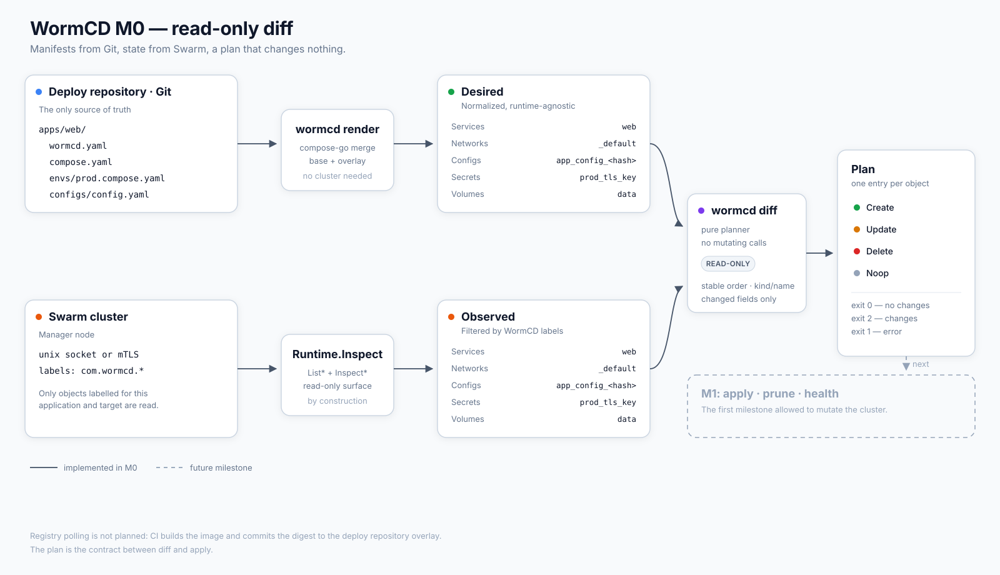

# WormCD


Declarative continuous delivery for Docker Swarm clusters.

WormCD watches a Git repository, renders Compose files with per-environment
overlays, and reconciles Docker Swarm clusters to the declared state — including
drift correction. It does not build images: CI builds them and commits the
image digest back to the deploy repository.

- Design: [docs/design/0001-v0-architecture.md](docs/design/0001-v0-architecture.md)
- Decisions: [docs/adr/](docs/adr/)
- Glossary: [GLOSSARY.md](GLOSSARY.md)

## Status

Early development. Compose/overlay rendering (`wormcd render`), read-only
Swarm inspection and read-only planning (`wormcd diff`) are implemented;
reconciliation (apply) is next.

| Capability | Status |
|---|---|
| Write `wormcd.yaml` + Compose + overlay, render `Desired` | `wormcd render` |
| Inspect a Swarm cluster read-only | `Runtime.Inspect` (internal) |
| Plan `Desired` vs `Observed` (`Create`/`Update`/`Delete`/`Noop`) | `wormcd diff`, exit `2` on drift |
| Apply, prune, self-heal | not yet (M1) |
| Fetch Git sources, multi-cluster targets | not yet (M2) |
| Webhooks, `syncPolicy`, rollback | not yet (M3) |
| Registry polling for new image versions | not planned: CI builds the image and commits the digest to the deploy repository |



To try it now, write the manifests in a local checkout, create the labelled
objects described in [cmd/wormcd/testdata/stand/README.md](cmd/wormcd/testdata/stand/README.md),
and run `wormcd diff`. A complete, renderable deploy repo lives in
[examples/deploy-repo](examples/deploy-repo/). WormCD does not deploy yet — use
`docker stack deploy` for the workload.

## Development

Requires Go 1.27+ and [mise](https://mise.jdx.dev/). The toolchain and every
linter version are pinned in `mise.toml`:

```sh
mise install              # install the pinned toolchain
mise run install-hooks    # install git hooks, once per clone
mise run check            # every check; this is the same command CI runs
mise run fix              # apply safe autofixes, then review the diff
```

```sh
make build
./bin/wormcd version
./bin/wormcd server --data wormcd.db --root /path/to/deploy-repo   # 127.0.0.1:8080
```

Render an application from a deploy repository (read-only, no cluster needed):

```sh
./bin/wormcd render --app web/prod --root /path/to/deploy-repo
./bin/wormcd render --file deploy/apps/web/wormcd.yaml --target prod --output json
```

Plan a target against a Swarm cluster (read-only):

```sh
./bin/wormcd diff --app web/prod --root /path/to/deploy-repo
./bin/wormcd diff --app web/prod --root /path/to/deploy-repo --output json
```

`diff` is read-only and, until the cluster registry arrives in M2, connects to
the local Docker socket (`unix:///var/run/docker.sock`). Exit codes: `0` — no
differences, `2` — the plan has changes, `1` — error.

Apply and inspect history (needs a SQLite database with `--data`):

```sh
./bin/wormcd sync web/staging --root /path/to/deploy-repo --data wormcd.db
./bin/wormcd status web/staging --root /path/to/deploy-repo --data wormcd.db
./bin/wormcd history web/staging --data wormcd.db
./bin/wormcd rollback web/staging --revision 3 --root /path/to/deploy-repo --data wormcd.db
```

`sync` applies the plan at once; use `diff` to preview it. The same operations
are served by `wormcd server` under `/api/v1/apps/{app}/targets/{target}`. The
API listens on loopback only in M1 and has no authentication yet. Every POST needs
a JSON Content-Type:

```sh
curl -X POST -H 'Content-Type: application/json' \
  http://127.0.0.1:8080/api/v1/apps/web/targets/staging/sync
curl -X POST -H 'Content-Type: application/json' -d '{"revision":3}' \
  http://127.0.0.1:8080/api/v1/apps/web/targets/staging/rollback
```

`sync`, `rollback` and `server` lock each target across processes with a `flock`
on a file in `locks/`, next to the database. A CLI run waits for a server run on
the same target, and the other way round, as long as both use the same database
directory on one host. `server` requires `--data`.

A run waits at most `--lock-timeout` for another run on the same target. The
default is `30s`, and the value must be positive. When the target stays locked
for that long, the run fails without writing anything: `sync` and `rollback`
exit with `1` and the API answers `409` with reason `sync_in_progress`. The
timeout covers only the wait; the run's own deadline starts once it holds the lock.

Known limits in M1:

- `history` lists only successful revisions, and their commit field is empty until M2. Failed attempts are only in the `events` table, which neither the CLI nor the API shows.
- A SIGTERM during a run can leave the target `Progressing` until the next manual `sync`.
- Lock files named `<app>-<target>.lock` from earlier builds in `locks/` are harmless and can be deleted.

Unit tests are hermetic. Docker integration tests are opt-in:

```sh
WORMCD_INTEGRATION=1 go test ./internal/cluster -run TestIntegrationPing -v
WORMCD_INTEGRATION=1 go test ./internal/runtime/swarm -run TestIntegrationInspect -v
WORMCD_INTEGRATION=1 go test ./cmd/wormcd -run TestIntegrationDiff -v
```

`TestIntegrationInspect` is read-only. `TestIntegrationInspectStack` and
`TestIntegrationDiff` create a disposable labelled stack, run the operation and
remove it again; both skip unless the daemon is a Swarm manager. The diff stand
is also available for manual runs — see
[cmd/wormcd/testdata/stand/README.md](cmd/wormcd/testdata/stand/README.md).

For a remote daemon or a dind Swarm, point the tests at it with mTLS:

```sh
WORMCD_INTEGRATION=1 \
WORMCD_DOCKER_ENDPOINT=tcp://host:2376 \
WORMCD_DOCKER_CA=ca.pem WORMCD_DOCKER_CERT=cert.pem WORMCD_DOCKER_KEY=key.pem \
go test ./...
```
